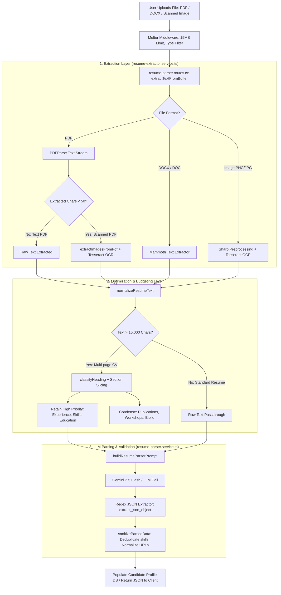
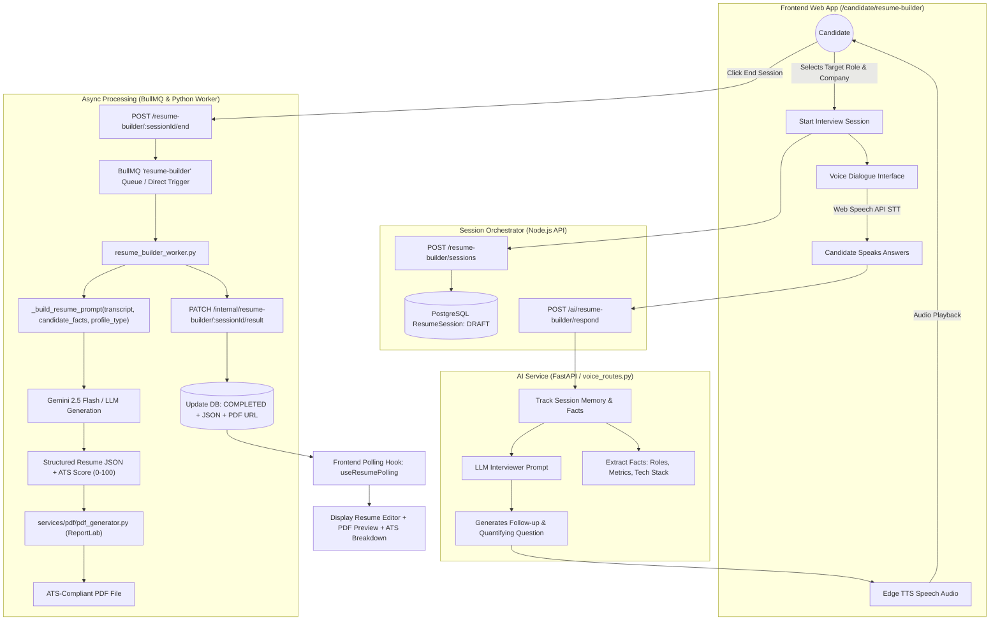

# 📄 Complete Technical Guide: Candidate Resume Parser & AI Resume Builder

This document explains the end-to-end architecture, step-by-step workflows, internal logic, and design decisions behind both the **Candidate Resume Parser** and the **AI Resume Builder** in NextRound.

You can use this guide to master the concepts yourself or explain them clearly in technical interviews, project presentations, and stakeholder demos.

---

## 📑 Table of Contents
1. [High-Level Overview & Difference](#1-high-level-overview--difference)
2. [Module 1: Candidate Resume Parser (Input: Document ➔ Output: Structured Profile)](#2-module-1-candidate-resume-parser)
   - [Workflow & Pipeline Diagram](#workflow--pipeline-diagram)
   - [Step-by-Step Execution Logic](#step-by-step-execution-logic)
   - [Deep Dive: Multi-tier Text Extraction (PDF, OCR, DOCX)](#deep-dive-multi-tier-text-extraction)
   - [Deep Dive: Section Categorization & Token Budgeting](#deep-dive-section-categorization--token-budgeting)
   - [Deep Dive: LLM Structured Parsing & Sanitization](#deep-dive-llm-structured-parsing--sanitization)
3. [Module 2: AI Voice Resume Builder (Input: Conversation ➔ Output: ATS Resume & PDF)](#3-module-2-ai-voice-resume-builder)
   - [Workflow & Pipeline Diagram](#workflow--pipeline-diagram-1)
   - [Step-by-Step Conversational Logic](#step-by-step-conversational-logic)
   - [Deep Dive: Memory, Facts Extraction & Adaptive Interviewing](#deep-dive-memory-facts-extraction--adaptive-interviewing)
   - [Deep Dive: Asynchronous BullMQ & AI Worker Pipeline](#deep-dive-asynchronous-bullmq--ai-worker-pipeline)
   - [Deep Dive: ATS Optimization & PDF Compilation](#deep-dive-ats-optimization--pdf-compilation)
4. [Comparison: Resume Parser vs. AI Resume Builder](#4-comparison-resume-parser-vs-ai-resume-builder)
5. [How to Explain This to an Interviewer or Evaluator (Speaking Script)](#5-how-to-explain-this-to-an-interviewer-or-evaluator)

---

## 1. High-Level Overview & Difference

Both components solve complementary problems in the candidate lifecycle:

| Feature | **Candidate Resume Parser** | **AI Voice Resume Builder** |
| :--- | :--- | :--- |
| **Primary Goal** | Ingest existing files (PDF/DOCX/Images) and automatically convert unstructured text into typed database profiles. | Guide a candidate who has no resume (or an outdated one) through a conversational interview to generate a polished, ATS-ready resume. |
| **Input** | Binary file upload (PDF, DOCX, PNG/JPG scans). | Real-time speech/voice answers + target job role + background facts. |
| **Core Mechanism** | OCR + Buffer Parsing ➔ Section Classifier ➔ Token Budgeting ➔ LLM Extraction ➔ Schema Sanitizer. | Web Speech STT/TTS ➔ Conversational Memory ➔ Asynchronous Background Worker ➔ ATS Scoring ➔ PDF Generator. |
| **Output** | Structured JSON (`fullName`, `skills`, `education`, `workExperience`, etc.) pre-populating candidate profile. | Downloadable ATS-formatted PDF + Editable Resume JSON + Section ATS Score Breakdown. |

---

## 2. Module 1: Candidate Resume Parser

### Workflow & Pipeline Diagram



---

### Step-by-Step Execution Logic

#### 1. Multer Ingestion & Security Filter
- **Where:** [`resume-parser.routes.ts`](file:///d:/Chirag/Collage%20work/Sem%20-%207/MP/NextRound/apps/api/src/routes/candidate/resume-parser.routes.ts)
- Accepts single file uploads up to **15 MB**.
- Validates file extensions (`.pdf`, `.docx`, `.doc`, `.txt`, `.png`, `.jpg`, `.jpeg`, `.webp`, `.tiff`) and MIME types.

#### 2. Hybrid Text Extraction (PDF / OCR / DOCX)
- **Where:** [`resume-extractor.service.ts`](file:///d:/Chirag/Collage%20work/Sem%20-%207/MP/NextRound/apps/api/src/services/resume/resume-extractor.service.ts)
- **Direct PDF Parsing:** Uses `pdf-parse` to read native digital PDF text streams.
- **Scanned PDF Fallback:** If `pdf-parse` yields `< 50` characters, the PDF is recognized as a scanned photo/image document. The service inspects binary byte markers for JPEG stream headers (`0xFF 0xD8 0xFF`) or unzips Flate streams, extracts page images, sharpens them via `sharp`, and runs **Tesseract OCR**.
- **Word Documents (`.docx`):** Uses `mammoth` to extract clean raw text while stripping styling tags.
- **Direct Image Uploads (`.png`, `.jpg`):** Passed through `sharp` (grayscale, threshold binarization) to optimize optical contrast before running Tesseract OCR.

#### 3. Section Categorization & Token Budgeting
- **The Problem:** Academic CVs or experienced executive resumes can be 10–30+ pages long (>100,000 characters). Sending raw multi-page text directly to an LLM risks token context bloat, high latency, hallucination, or request timeouts.
- **The Solution (`optimizeResumeContent`):**
  1. **Regex Heading Classifier:** Scans each line against regex rules classifying sections into:
     - High priority: `experience`, `skills`, `education`, `projects`, `certifications`
     - Low priority: `publications`, `workshops`, `references`, `other`
  2. **Budgeting Algorithm:**
     - High priority sections are allocated ample capacity (e.g., Experience up to 10,000 chars, Skills up to 4,000 chars).
     - Low priority sections (like dozens of conference papers or bibliography entries) are intelligently sliced and condensed (e.g., keeping the top citations and appending `[Additional publication entries omitted for AI profile extraction efficiency]`).
     - Clamps total payload to an optimal **~20,000–24,000 character target budget**.

#### 4. LLM Structured Extraction
- **Where:** [`parseResumeWithGemini` in `resume-parser.service.ts`](file:///d:/Chirag/Collage%20work/Sem%20-%207/MP/NextRound/apps/api/src/services/resume/resume-parser.service.ts#L68-L100)
- The structured prompt forces the LLM to output pure JSON matching the TypeScript schema `ParsedResumeData`:
  - `fullName`, `headline`, `currentCompany`, `currentTitle`
  - `skills` (categorized and normalized)
  - `education` (degrees, institutions, start/end years, GPA)
  - `workExperience` (roles, companies, bullet points)
  - `targetRoles`, `yearsOfExperience`, `location`, `linkedinUrl`, `githubUrl`

#### 5. Data Sanitization & Normalization
- **Where:** [`resume-heuristic.service.ts`](file:///d:/Chirag/Collage%20work/Sem%20-%207/MP/NextRound/apps/api/src/services/resume/resume-heuristic.service.ts)
- Cleans trailing punctuation, strips markdown wrappers (` ```json `), standardizes URLs (ensuring `https://` prefix for GitHub/LinkedIn), and dedupes skill tags before saving to the database.

---

## 3. Module 2: AI Voice Resume Builder

### Workflow & Pipeline Diagram



---

### Step-by-Step Conversational Logic

#### 1. Session Initialization
- Candidate defines **Target Role** (e.g., "Full Stack Engineer"), **Target Company** (e.g., "Google" or "Stripe"), and optionally attaches their previous rough notes or profile type (`student`, `fresher`, `experienced`, `career_changer`).
- The API creates a `ResumeSession` row in PostgreSQL with status `DRAFT`.

#### 2. Adaptive Voice Interview & Fact Extraction
- Instead of filling out boring static forms, an AI interviewer conducts a 5–10 turn conversation.
- **Adaptive Questioning:**
  - If candidate answers: *"I built a payment system"*, the AI immediately asks: *"What stack did you use, what was the transaction volume, and did you encounter failure handling challenges?"*
  - This extracts **quantifiable metrics** (e.g., "reduced latency by 35%", "handled 10k daily transactions").
- **Memory Tracking:** With every turn, the conversation records:
  - `transcript`: User and AI message history.
  - `candidate_facts`: Atomic statements extracted on the fly (e.g., `"Led team of 4"`, `"Proficient in Go and Kubernetes"`).
  - `covered_topics`: Keeps track of completed areas (`contact`, `work_history`, `education`, `skills`, `projects`).

#### 3. Ending Session & Background Job Dispatch
- When the user finishes speaking, the frontend calls `POST /resume-builder/:sessionId/end`.
- The session transitions to `GENERATING`.
- To prevent browser timeouts during heavy LLM generation and PDF layout rendering, the task is enqueued to **BullMQ / Background Worker** (`resume-builder-worker`).

#### 4. The Resume Generation Engine (`resume_builder_worker.py`)
- **Profile Guidance Ingestion:** Customizes tone depending on `profileType`:
  - **Student / Fresher:** Prioritizes Education, Projects, and Hackathons over Work Experience.
  - **Experienced:** Prioritizes leadership, business impact, and quantified bullet points.
  - **Career Changer:** Prominently highlights transferable skills.
- **ATS Bullet Point Formatting:**
  - Enforces the Google/XYZ formula: *"Accomplished [X], as measured by [Y], by doing [Z]"*.
  - Every bullet starts with a past-tense action verb (e.g., *Architected*, *Spearheaded*, *Optimized*).
- **ATS Scoring Algorithm:**
  - Computes a score from 0 to 100 based on 5 weighted pillars:
    1. **Keyword Relevance (90/100):** Alignment with target job role.
    2. **Quantifiable Impact (85/100):** Percentage of bullet points containing numbers/metrics.
    3. **Action Verb Strength (88/100):** Absence of weak phrases like "helped with" or "worked on".
    4. **Structural Formatting (95/100):** Standard ATS header hierarchy.
    5. **Skill Alignment (90/100):** Grouped into Languages, Frameworks, Cloud, Databases.

#### 5. ReportLab PDF Generation & Presentation
- Generates a clean ATS-compliant PDF:
  - Standard system fonts (Helvetica/Times), single-column flow, no unparseable floating tables.
  - High machine readability for third-party ATS parsers (Workday, Greenhouse, Lever).
- Saves the PDF to disk or cloud storage and sends the download URL + JSON back to the candidate dashboard.

---

## 4. Comparison: Resume Parser vs. AI Resume Builder

| Aspect | Resume Parser | AI Resume Builder |
| :--- | :--- | :--- |
| **Input Format** | Unstructured binary file (PDF/DOCX/Images). | Real-time candidate voice dialogue / transcript. |
| **User Effort** | 5 seconds (Just upload a file). | 5 to 10 minutes (Interactive interview). |
| **Main Challenge** | OCR noise, multi-column resume layouts, token bloat on 20-page academic CVs. | Helping candidate recall achievements, prompting for metrics, converting conversational slang into resume phrasing. |
| **LLM Output** | Exact profile representation of what already existed on paper. | Enhanced, rephrased, quantified ATS resume that did not exist before. |
| **Fail-safe Logic** | Direct text extraction fallback to Tesseract OCR; Section budgeting if >15k chars. | Adaptive profile defaults, fallback direct HTTP trigger if Redis worker queue is busy. |

---

## 5. How to Explain This to an Interviewer or Evaluator

When asked in an interview or project review: **"How does the resume system work in your platform?"**, here is a structured 3-minute speaking script:

### 🎙️ The 3-Minute Elevator Pitch

> *"In NextRound, our resume architecture solves both sides of the candidate onboarding coin:*
> 
> *1. **First, the Candidate Resume Parser:** For candidates who already have a resume, we provide an intelligent ingestion pipeline. Instead of just doing a basic text dump, we use a 3-tier extraction strategy: digital text parsing with `pdf-parse`, OCR fallback with `sharp` and `Tesseract` for scanned documents, and `mammoth` for DOCX.
> If a candidate uploads an extensive academic CV with 20 pages, sending it directly to an LLM would blow the token limit and cause timeouts. So we built an intelligent Token Budgeter that classifies sections via Regex. It retains 100% of the candidate's Experience, Skills, and Projects while summarizing long bibliographies down to an optimal 22,000-character budget. Then, Gemini extracts and normalizes the data into a strictly typed profile schema.*
> 
> *2. **Second, the AI Voice Resume Builder:** For students, freshers, or candidates whose resumes are outdated, we built an interactive AI interviewer. The candidate speaks directly to the AI, which acts as a career coach.
> The AI dynamically probes for metrics—if the candidate says 'I built an e-commerce backend', the AI follows up: 'How many daily users and what database did you use?'.
> Once the conversation finishes, an asynchronous BullMQ worker runs our Python generation pipeline. It scores the resume against ATS standards across 5 dimensions (keywords, quantifiable impact, action verbs, structure, and skill alignment) and automatically compiles an ATS-compliant PDF ready for download.*
> 
> *This architecture completely eliminates manual data entry and helps candidates create interview-ready resumes in minutes."*

---

## 6. Key Source Files in the Repository

| Component | File Path |
| :--- | :--- |
| **Parser Endpoints** | [`apps/api/src/routes/candidate/resume-parser.routes.ts`](file:///d:/Chirag/Collage%20work/Sem%20-%207/MP/NextRound/apps/api/src/routes/candidate/resume-parser.routes.ts) |
| **Parser Service & LLM** | [`apps/api/src/services/resume/resume-parser.service.ts`](file:///d:/Chirag/Collage%20work/Sem%20-%207/MP/NextRound/apps/api/src/services/resume/resume-parser.service.ts) |
| **Text Extraction & Budgeting** | [`apps/api/src/services/resume/resume-extractor.service.ts`](file:///d:/Chirag/Collage%20work/Sem%20-%207/MP/NextRound/apps/api/src/services/resume/resume-extractor.service.ts) |
| **Sanitization & Types** | [`apps/api/src/services/resume/resume-heuristic.service.ts`](file:///d:/Chirag/Collage%20work/Sem%20-%207/MP/NextRound/apps/api/src/services/resume/resume-heuristic.service.ts) |
| **AI Resume Builder Worker** | [`apps/ai-service/workers/resume_builder_worker.py`](file:///d:/Chirag/Collage%20work/Sem%20-%207/MP/NextRound/apps/ai-service/workers/resume_builder_worker.py) |
| **Voice Routes & Streaming** | [`apps/ai-service/routes/voice_routes.py`](file:///d:/Chirag/Collage%20work/Sem%20-%207/MP/NextRound/apps/ai-service/routes/voice_routes.py) |
| **Resume Builder Web UI** | [`apps/web/src/app/candidate/resume-builder/page.tsx`](file:///d:/Chirag/Collage%20work/Sem%20-%207/MP/NextRound/apps/web/src/app/candidate/resume-builder/page.tsx) |
